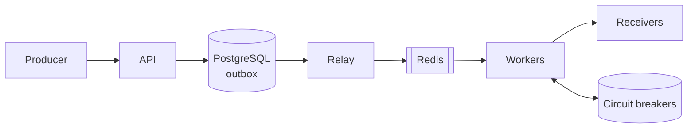

# hookrelay

[](https://github.com/blitzlab/hookrelay/actions/workflows/ci.yml)

Reliable, at-least-once webhook delivery built with **Django, Celery, PostgreSQL and Redis**.

Producers publish an event once. hookrelay fans it out to every subscribed endpoint as a signed HTTP request and keeps retrying through receiver outages, worker crashes and broker restarts.



## What it demonstrates

| Pattern | Where |
| --- | --- |
| Transactional outbox (no dual writes) | [`services/outbox.py`](apps/webhooks/services/outbox.py) |
| `SELECT ... FOR UPDATE SKIP LOCKED` work distribution | [`services/dispatch.py`](apps/webhooks/services/dispatch.py) |
| Lease-based idempotent task execution | `claim_delivery` in `dispatch.py` |
| Exponential backoff with full jitter | [`services/backoff.py`](apps/webhooks/services/backoff.py) |
| Fleet-wide circuit breaker in Redis | [`services/circuit_breaker.py`](apps/webhooks/services/circuit_breaker.py) |
| Producer idempotency keys | `Idempotency-Key` header on `POST /api/events/` |
| HMAC-SHA256 signing with replay protection | [`services/signing.py`](apps/webhooks/services/signing.py) |
| Dead-letter queue and replay | `POST /api/deliveries/{id}/replay/` |
| Self-healing sweeper for lost broker messages | `sweep_stale_deliveries` in [`tasks.py`](apps/webhooks/tasks.py) |
| SSRF guard on subscriber URLs | [`services/url_guard.py`](apps/webhooks/services/url_guard.py) |

The full write-up (requirements, data model, state machine, failure modes, capacity estimate, trade-offs) is in **[docs/system-design.md](docs/system-design.md)**.

## Quick start

```bash
docker compose up --build            # API, relay, workers, beat, Postgres, Redis, flaky receiver
bash scripts/demo.sh                 # register an endpoint, publish 25 events, print results
docker compose up --scale worker=4   # scale delivery workers out
```

The demo receiver fails 30% of requests on purpose, so you can watch retries happen with `make logs`.

## API

```bash
# Register an endpoint (the response includes its signing secret)
curl -X POST localhost:8000/api/endpoints/ -H 'Content-Type: application/json' \
  -d '{"url": "https://example.com/webhooks", "event_types": ["order.created"]}'

# Publish an event. Retrying with the same key never publishes twice.
curl -X POST localhost:8000/api/events/ -H 'Content-Type: application/json' \
  -H 'Idempotency-Key: order-42-created' \
  -d '{"event_type": "order.created", "payload": {"order_id": 42}}'

# Inspect deliveries, replay dead ones, check an endpoint's breaker
curl 'localhost:8000/api/deliveries/?status=dead'
curl -X POST localhost:8000/api/deliveries/<id>/replay/
curl localhost:8000/api/endpoints/<id>/circuit/
```

Set `HOOKRELAY_API_KEY` to require `Authorization: Bearer <key>` on every API call.

## Verifying webhooks (receiver side)

Every request carries `Webhook-Id` (stable across retries, use it to dedupe), `Webhook-Attempt` and `Webhook-Signature: t=<unix>,v1=<hmac>`.

```python
from apps.webhooks.services.signing import verify_signature  # no Django dependency

verify_signature(secret, request.body, request.headers["Webhook-Signature"])
```

## Delivery guarantees

- **At-least-once** per (event, endpoint). Dedupe on `Webhook-Id` for exactly-once effects.
- **No lost events:** PostgreSQL is the source of truth; Celery is only a trigger.
- **Bounded retries:** `HOOKRELAY_MAX_ATTEMPTS` (default 8) with backoff capped at 1 hour, then the dead-letter queue.
- **Isolation:** a failing receiver trips its breaker for every worker and stops consuming attempts.

## Running tests

```bash
pip install -r requirements-dev.txt
pytest   # needs PostgreSQL (see .env.example); Redis is faked
```

52 tests cover signing, backoff, the circuit breaker state machine, idempotent ingestion, outbox relay (including a `SKIP LOCKED` concurrency test), retries, dead-lettering, leases and the sweeper.

## Project layout

```
config/                  settings, Celery app, URLs
apps/webhooks/
  models.py              Endpoint, Event, OutboxMessage, Delivery, DeliveryAttempt
  services/              outbox, dispatch, backoff, circuit breaker, signing, url guard
  tasks.py               relay_outbox, deliver, sweep_stale_deliveries
  views.py               REST API and /healthz
scripts/                 flaky receiver and demo
docs/system-design.md    design write-up
```

## License

MIT
