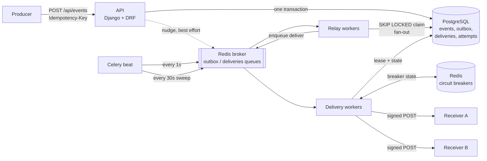
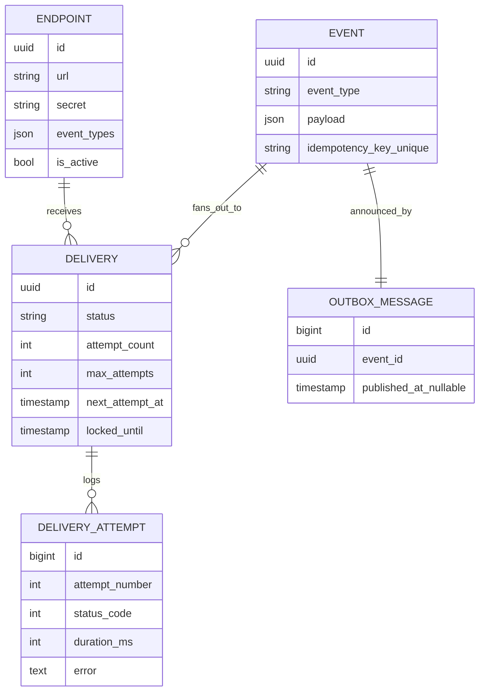
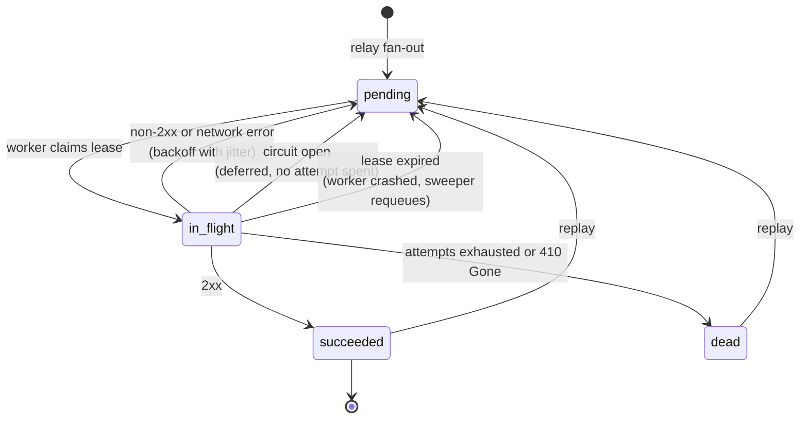
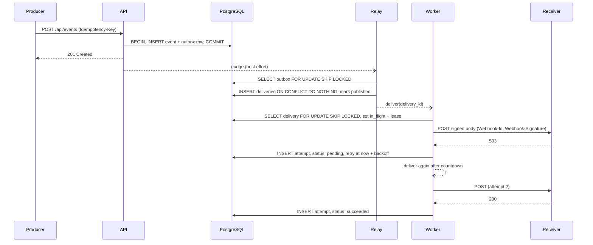

# hookrelay: System Design

A webhook delivery service: producers publish events once, and hookrelay delivers a signed HTTP request to every subscribed endpoint, retrying through receiver outages, worker crashes and broker restarts without losing or duplicating work it has accepted.

## 1. Requirements

**Functional**

- Register endpoints (URL, event type filter, signing secret).
- Publish events through an API. Retrying the same request must not publish twice.
- Deliver each event to every matching endpoint as a signed `POST`.
- Retry failed deliveries with backoff, then park them in a dead-letter queue.
- Inspect deliveries and every attempt; replay dead deliveries.

**Non-functional**

| Property | Target |
| --- | --- |
| Durability | An accepted event is never lost, even if the broker loses its data. |
| Delivery semantics | At-least-once per (event, endpoint). Receivers dedupe on `Webhook-Id`. |
| Isolation | One failing receiver must not exhaust workers or retry budgets for others. |
| Availability | Ingestion keeps working when the broker is down. |
| Horizontal scale | Every process type (API, relay, worker) scales by adding replicas. |
| Security | Receivers can verify origin and freshness; endpoints cannot target internal hosts. |

## 2. Architecture

Three process types, all stateless and independently scalable:

- **API** validates input and writes the event plus an outbox row in one transaction.
- **Relay** drains the outbox and creates one `Delivery` per subscribed endpoint.
- **Workers** send HTTP requests, record attempts and schedule retries.

PostgreSQL is the source of truth for every delivery. Celery and Redis only decide *when* work runs, never *whether* it exists.

## 3. Data model

Indexes that matter:

- `outbox_unpublished_idx`: partial index on `id WHERE published_at IS NULL`, so the relay scans only the unpublished tail no matter how large the table grows.
- `uniq_delivery_per_event_endpoint`: makes fan-out idempotent.
- `delivery_due_idx` on `(status, next_attempt_at)`: serves the sweeper and dashboards.
- Unique `idempotency_key` on events: enforces producer idempotency even under concurrent retries.

## 4. Delivery lifecycle

## 5. Request flow

## 6. Key design decisions

### 6.1 Transactional outbox instead of dual writes

Writing to the database and then publishing to the broker (or the reverse) has a failure window where one succeeds and the other does not, which either loses events or publishes events that were rolled back. Writing the event and an outbox row in the same transaction closes that window. A relay publishes from the outbox afterwards.

*Trade-off:* extra write per event and up to one poll interval of added latency. The API nudges the relay after commit, so latency is usually milliseconds, and the poll is only the fallback.

### 6.2 Database as source of truth, broker as trigger

Every state transition is committed before a task is enqueued. If Redis loses messages (restart without persistence, eviction, a worker killed while holding a prefetched ETA task), nothing is lost: the sweeper finds `pending` deliveries that are overdue by more than a grace period and re-enqueues them.

*Trade-off:* the sweeper adds periodic queries, and recovery after message loss takes up to `grace + sweep interval` (about 90s by default).

### 6.3 `FOR UPDATE SKIP LOCKED` for work distribution

Both the relay and the delivery claim use `SELECT ... FOR UPDATE SKIP LOCKED OF self`. Concurrent relays take disjoint batches without blocking each other, which turns PostgreSQL into a safe work queue. `OF self` avoids locking the joined `event` and `endpoint` rows. A test opens a second connection that holds locks and asserts the relay skips those rows.

### 6.4 Idempotent tasks through leases

Celery with `acks_late` gives at-least-once task execution, so a `deliver` task can run twice. Before sending, a worker must move the row from `pending` (and due) to `in_flight` with a lease (`locked_until`). A second copy of the task finds the row in flight, finished, or not yet due, and exits. If the worker dies mid-request, the lease expires and the sweeper hands the delivery to another worker.

### 6.5 At-least-once delivery, exactly-once effects at the receiver

Exactly-once delivery over HTTP is impossible: a receiver can process a request and then time out before responding. hookrelay therefore promises at-least-once delivery and sends a stable `Webhook-Id` (the event id) on every attempt so receivers can dedupe. The bundled `flaky_receiver.py` demonstrates the pattern.

### 6.6 Exponential backoff with full jitter

`delay = uniform(0, min(cap, base * 2^(n-1)))`, floored at 1s. Without jitter, every delivery that failed during an outage retries at the same instants and hammers the receiver as it recovers. Full jitter spreads them evenly across the window.

### 6.7 Fleet-wide circuit breaker in Redis

Each endpoint has a breaker whose state lives in Redis, so all workers share it. After `threshold` failures inside the window, the breaker opens and deliveries to that endpoint are deferred *without consuming an attempt*. After the cooldown one worker (chosen with `SET NX`) sends a probe. Success closes the breaker. Failure reopens it with a doubled cooldown, capped.

This gives isolation: a dead receiver stops tying up worker slots and burning retry budgets within a handful of requests. Only network errors, 429 and 5xx count as failures, since other 4xx responses say the request was rejected, not that the receiver is down.

### 6.8 Producer idempotency keys

`Idempotency-Key` is stored with a unique constraint. A retry with the same key and body returns the original event (`200`, `Idempotent-Replayed: true`). The same key with a different body returns `409`. Concurrent duplicates are resolved by catching the unique violation and returning the winner.

### 6.9 Signing and replay protection

`Webhook-Signature: t=<unix>,v1=<hex>` where the HMAC-SHA256 covers `"<t>.<raw body>"`. Receivers verify with a constant-time comparison and reject timestamps outside a 5 minute window, which blocks replay of captured requests. The signing module has no Django dependency so receivers can copy it.

### 6.10 SSRF guard

Endpoint URLs are resolved at registration and rejected if any address is private, loopback, link-local, multicast or reserved (for example cloud metadata at `169.254.169.254`). Requests never follow redirects, so a public URL cannot bounce the worker to an internal host.

## 7. Failure modes

| Failure | What happens | Recovery |
| --- | --- | --- |
| Receiver returns 5xx or times out | Attempt logged, retry scheduled with backoff | Automatic until `max_attempts`, then dead-letter |
| Receiver down for a long time | Breaker opens fleet-wide, deliveries deferred without spending attempts | Half-open probe; closes on first success |
| Receiver returns 410 Gone | Delivery dead, endpoint deactivated | Operator re-enables and replays |
| Worker killed mid-request | Row stays `in_flight` with a lease | Lease expires, sweeper requeues, another worker sends |
| Broker down during ingestion | API still returns 201; outbox rows accumulate | Beat relays the backlog when the broker returns |
| Broker loses queued messages | Deliveries stay `pending` in PostgreSQL | Sweeper requeues overdue deliveries |
| Duplicate task execution | Second copy fails to claim the lease and exits | None needed |
| Relay crashes after fan-out, before commit | Transaction rolls back, outbox row stays unpublished | Next relay run redoes it; unique constraint prevents duplicates |
| Producer retries after timeout | Same `Idempotency-Key` returns the original event | None needed |
| Redis (breaker store) down | Workers cannot read breaker state; tasks fail and are retried by Celery/sweeper | Resumes when Redis returns |

## 8. Scaling and capacity

Back-of-envelope for 10M events/day with an average fan-out of 3:

- Average 116 events/s, so assume a 5x peak of about 600 events/s, or 1,800 deliveries/s.
- With 200 ms average receiver latency, Little's law gives 1,800 x 0.2 = 360 concurrent requests. At 16 threads per worker process that is about 23 worker processes. Switching the pool to gevent raises concurrency per process because the work is I/O bound.
- Writes: per event about 1 event row, 1 outbox row, 3 deliveries, and about 3.5 attempts including retries. At peak that is roughly 5,000 row writes/s, comfortably within a single tuned PostgreSQL primary.
- Storage: at 2 KB per payload, events alone are about 20 GB/day. Attempts and events should be range-partitioned by day and dropped after the retention window instead of deleted row by row.

How each tier scales:

| Tier | Scaling approach |
| --- | --- |
| API | Stateless; add replicas behind a load balancer. |
| Relay | Add replicas; `SKIP LOCKED` keeps batches disjoint. |
| Workers | Add replicas or switch to gevent; breakers keep bad endpoints from eating capacity. |
| PostgreSQL | Partition hot tables by time; read replicas for dashboards; shard by tenant if one primary is not enough. |
| Redis | Separate instances for broker and breaker state; Redis Cluster if needed. |

## 9. Verified behaviour

Measured on a local stack (API on gunicorn, one Celery worker with 8 threads, beat, PostgreSQL 16, Redis 7):

- **Flaky receiver:** 50 events sent to a receiver failing 40% of requests on purpose. All 50 were delivered after 95 attempts, at most 7 attempts for any single delivery. All signatures verified, with zero duplicates processed.
- **Idempotency:** replaying a key returned `200` with the original event; reusing it with a different body returned `409`.
- **Broker outage:** Redis was stopped and 10 more events were published. Every request still returned `201`, and `/healthz` reported `503 degraded`. After Redis restarted, the backlog was relayed and all 60 deliveries succeeded.
- **Test suite:** 52 tests against real PostgreSQL, including a concurrency test for `SKIP LOCKED`.

## 10. Limitations and next steps

- **Noisy neighbours:** all endpoints share one `deliveries` queue. A slow (not failing) receiver can still occupy worker slots. Next step: per-endpoint concurrency limits or weighted fair queuing with per-endpoint Redis lists.
- **Rate limiting:** add a token bucket per endpoint (Redis + Lua) so receivers can declare a maximum request rate.
- **Ordering:** deliveries are unordered. Per-endpoint ordering would need a sequence number and a single in-flight delivery per (endpoint, ordering key).
- **DNS rebinding:** the SSRF check runs at registration. Pinning the resolved IP at request time would close the rebinding gap.
- **Secret rotation:** send two signatures (old and new secret) during a rotation window.
- **Observability:** export Prometheus metrics (attempt latency, success rate per endpoint, breaker state, outbox lag) and propagate trace ids into webhook headers.
- **Retention:** time-partition `event` and `delivery_attempt` and drop old partitions.
